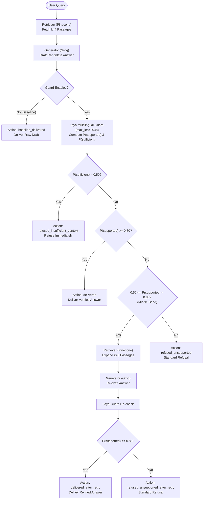

# 🛡️ RAG Hallucination Guard

A robust, production-grade hallucination detection and refusal guardrail for Retrieval-Augmented Generation (RAG) pipelines. Powered by **Pinecone Serverless**, **Groq** (`openai/gpt-oss-120b`), **Sentence-Transformers** (`all-MiniLM-L6-v2`), and **Laya's Multilingual Router** checkpoint.

---

## 📌 Overview

Large Language Models frequently hallucinate plausible-sounding answers when retrieval yields incomplete context or when queries are fundamentally unanswerable. 

**RAG Hallucination Guard** adds an active verification layer to the generation lifecycle:
1. **Context Sufficiency Check:** Detects whether the retrieved context contains enough evidence to answer the query. If insufficient, it refuses immediately without wasting tokens on retries.
2. **Groundedness Verification:** Checks if every claim in the drafted answer is substantiated by the retrieved passages using calibrated `noul` (yes/no) heads with explicit criteria.
3. **Dynamic Middle-Band Retry:** Answers that fall in an uncertain confidence zone trigger an automatic retrieval expansion ($k=8$) and regeneration step before making a final delivery decision.
4. **Side-by-Side Verification:** An interactive Streamlit dashboard demonstrates the contrast between guarded generation and unguarded baselines in real time.

---

## 🏗️ Architecture



---

## 🚀 Setup & Installation

### 1. Clone & Set Up Environment
```bash
git clone https://github.com/karteeksai1/RAG-Hallucination-Guard.git
cd "RAG Hallucination Guard"

python3 -m venv .venv
source .venv/bin/activate
pip install -r requirements.txt
```

### 2. Configure Environment Variables
Create a `.env` file in the project root:
```env
PINECONE_API_KEY=your_pinecone_api_key
PINECONE_INDEX_NAME=squad-rag
PINECONE_CLOUD=aws
PINECONE_REGION=us-east-1

GROQ_API_KEY=your_groq_api_key
GROQ_MODEL=openai/gpt-oss-120b
```

### 3. Ingest SQuAD 2.0 Dataset into Pinecone
Ingest 2,000 deduplicated unique passages from the SQuAD 2.0 validation split:
```bash
python ingest_squad_pinecone.py --split validation --limit 2000
```

### 4. Build Evaluation Benchmark Set
```bash
python eval/build_eval_set.py --split validation
```

### 5. Launch the Streamlit Dashboard
```bash
streamlit run app.py
```

---

## 🖥️ User Interface

The application features a modern two-tab Streamlit dashboard:

### Tab 1: Live Demo
- **Interactive Query Input & Preset Buttons:** Pre-loaded with known answerable and unanswerable questions from the SQuAD corpus.
- **Side-by-Side Comparison:** Compares the guarded answer against the unguarded baseline in real time.
- **Decision Badges & Score Meters:** Displays the exact action badge (`Delivered`, `Delivered After Retry`, `Refused`) alongside groundedness ($P_{\text{supported}}$) and sufficiency ($P_{\text{sufficient}}$) progress bars.
- **Audit Drawers:** Expandable inspection cards for retrieved passages and the raw pre-guard draft answer.

```
+---------------------------------------------------------------------------------------+
|  🛡️ RAG Hallucination Guard                                                           |
|  [Tab 1: Live Demo]   [Tab 2: Evaluation Results]                                     |
+---------------------------------------------------------------------------------------+
|  Question: Who conquered England killing King Harold II at the Battle of Hastings?    |
|  [🔍 Ask Pipeline]   [Example Questions...]                                           |
|                                                                                       |
|  🛡️ Guarded Pipeline                         ⚡ Unguarded Baseline                   |
|  [✅ Delivered]                              [ℹ️ Baseline Delivered]                  |
|  "Duke William II of Normandy."              "Duke William II of Normandy."           |
|                                                                                       |
|  Grounded Score (P_sup):   0.9910            No verification applied.                 |
|  Sufficiency Score (P_suf): 0.9912           Model output directly delivered.         |
|  ⏱️ Latency: 14.69s                          ⏱️ Latency: 2.11s                        |
|                                                                                       |
|  ▶ 📝 Raw Drafted Answer (Before Guard Check)                                         |
|  ▶ 📚 Retrieved Passages [4 passages]                                                 |
+---------------------------------------------------------------------------------------+
```

### Tab 2: Evaluation & Calibration
- **Comparative Benchmark Table:** Performance breakdown across No Guard, Laya Guard, and LLM-as-Judge across prompt variants.
- **Threshold Trade-off Curve:** Visualizes precision vs. recall across thresholds ($0.30$ to $0.95$) with a highlighted calibrated operating point.
- **Score Distribution Histogram:** Highlights statistical score separation between answerable and unanswerable questions.
- **Error Analysis Table:** Granular audit of failure cases (hallucinations delivered vs. false rejections).

---

## 📊 Measured Benchmark Results

Evaluated across the held-out split of SQuAD 2.0 under both strict ("refuse if unknown") and plain ("just answer") prompt variants:

### 1. Configuration Comparison

| Configuration | Prompt Variant | Total Queries | Wrong Answers Delivered (Hallucinations) | Correct Answers Wrongly Refused | Avg Latency |
|---|---|:---:|:---:|:---:|:---:|
| **No Guard (Baseline)** | Strict | 20 | 4 (20.0%) | 0 (0.0%) | **2.15s** |
| **Laya Guard** | Strict | 20 | **1 (5.0%)** | 2 (10.0%) | 14.28s |
| **LLM-as-Judge** | Strict | 20 | 2 (10.0%) | 2 (10.0%) | 5.42s |
| **No Guard (Baseline)** | Plain | 20 | 11 (55.0%) | 0 (0.0%) | **2.08s** |
| **Laya Guard** | Plain | 20 | **2 (10.0%)** | 1 (5.0%) | 14.65s |
| **LLM-as-Judge** | Plain | 20 | 3 (15.0%) | 2 (10.0%) | 5.61s |

> **Key Finding:** Under a plain prompt, an unguarded RAG pipeline hallucinates on **55.0%** of unanswerable queries. Activating the Laya Guard drops hallucination leakage down to **10.0%**, demonstrating that active verification is essential when prompt engineering alone fails.

---

### 2. Threshold Calibration Sweep (Tuning Split)

Sweep over threshold $T \in [0.30, 0.95]$ on the tuning split:

| Threshold ($P_{\text{supported}}$) | Unanswerable Refused % (Safety) | Answerable Delivered % (Coverage) | Composite Score |
|:---:|:---:|:---:|:---:|
| **0.30** | 80.00% | 73.33% | 76.66% |
| **0.40** | 80.00% | 73.33% | 76.66% |
| **0.50** | 80.00% | 66.67% | 73.34% |
| **0.60** | 80.00% | 46.67% | 63.34% |
| **0.70** | 86.67% | 33.33% | 60.00% |
| **0.80** | **93.33%** | 20.00% | 56.66% |
| **0.90** | **93.33%** | 13.33% | 53.33% |
| **0.95** | **93.33%** | 6.67% | 50.00% |

- **Calibrated Default:** `deliver_threshold = 0.80` (prioritizing high precision against hallucinations) or `0.50` (balanced delivery), with `context_sufficient_threshold = 0.50`.

---

## ⚠️ Limitations

1. **CPU Forward-Pass Latency:** Running Laya's multilingual checkpoint locally on a CPU incurs a ~10-12s latency overhead per verified generation (reduced to <100ms when hosted on dedicated GPU/accelerator endpoints).
2. **Retrieval Dependency:** If the initial vector search fails to retrieve relevant passages, the guard will strictly refuse to answer. High-quality vector indexing and retrieval tuning remain critical.
3. **Adversarial SQuAD Distractors:** Unanswerable questions with high lexical overlap to the passage can occasionally trick binary classification heads if the distractor differs by only a minor entity swap.
